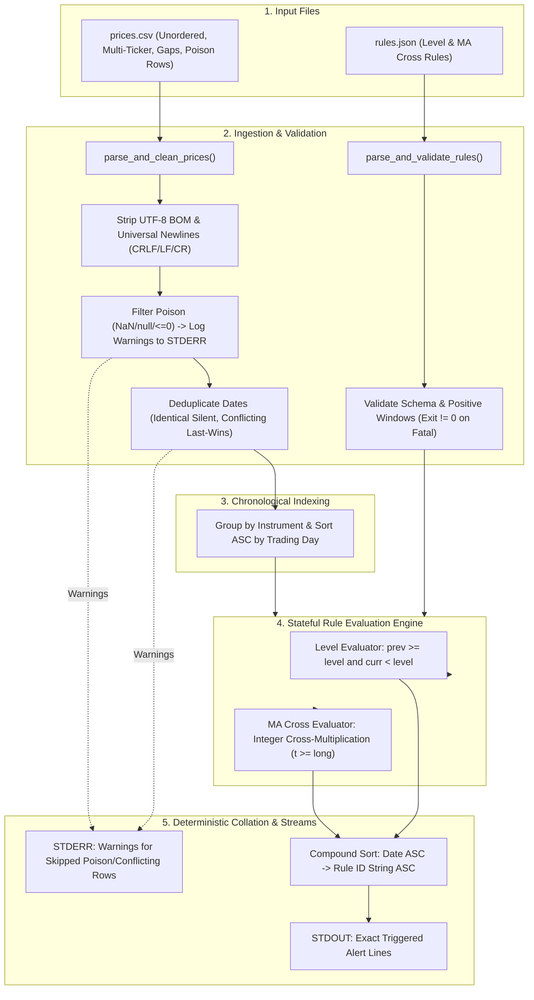

# Price Alert Tool

A standalone, zero-dependency command-line utility for technical market monitoring built for the **Wissen Technology Campus Assessment**. Ingests historical daily prices from CSV, evaluates stateful `level` and `ma_cross` alert rules from JSON, and prints triggered events in strict deterministic order.

---

## How to run it

### Clean Download & Execution
**Prerequisites:** Python 3.8+  
**Dependencies:** **Zero external dependencies.** Built strictly using the Python Standard Library (`sys`, `csv`, `json`, `pathlib`, `datetime`, `decimal`, `unittest`). There is **nothing to install**.

```bash
# Execute CLI with bundled sample dataset
python alerts.py sample_data/sample_prices.csv sample_data/sample_rules.json

# Execute CLI with any custom files
python alerts.py <prices.csv> <rules.json>
```

### Running the Verification Test Suite
The codebase includes a comprehensive 24-test verification suite covering realistic data anomalies, encodings, and hostile edge cases:

```bash
python -m unittest discover -s tests -p "test_*.py"
```

---

## Data Pipeline Flowchart

The diagram below illustrates how raw, out-of-order market data and alert rules pass through `alerts.py` to produce deterministic standard output and standard error streams:



---

## Intermediate Data Stages & Internal Representations

When `alerts.py` executes, data transforms across several intermediate stages:

### Stage 1: Raw Inputs Ingestion

#### `sample_data/sample_rules.json` (Input Rules)
```json
[
  {"id": "r1", "instrument": "INFY", "type": "level", "direction": "below", "level": 1500},
  {"id": "r2", "instrument": "TCS", "type": "ma_cross", "short": 5, "long": 20, "direction": "above"},
  {"id": "r3", "instrument": "RELIANCE", "type": "level", "direction": "above", "level": 2500}
]
```

#### `sample_data/sample_prices.csv` (Raw Ingest with Anomalies)
```csv
date,instrument,close
2026-09-03,INFY,1498.00
2026-09-01,TCS,3890.00
2026-09-01,INFY,1525.00
2026-09-24,TCS,4200.00
2026-09-02,INFY,1534.10
2026-09-01,INFY,1520.50
2026-09-15,TCS,NaN
```
*(Notice: dates are out of chronological order, `INFY` has conflicting duplicate rows for `2026-09-01`, and `TCS` contains a poison `NaN` line).*

---

### Stage 2: Parsed & Normalized Rules Structure
Output of `parse_and_validate_rules()`:
```python
rules = [
    {
        "id": "r1",
        "instrument": "INFY",
        "type": "level",
        "direction": "below",
        "level": Decimal("1500"),
    },
    {
        "id": "r2",
        "instrument": "TCS",
        "type": "ma_cross",
        "direction": "above",
        "short": 5,
        "long": 20,
    },
    {
        "id": "r3",
        "instrument": "RELIANCE",
        "type": "level",
        "direction": "above",
        "level": Decimal("2500"),
    },
]
```

---

### Stage 3: Cleaned & Chronologically Sorted Price Series
Output of `parse_and_clean_prices()`:
Poison `NaN` row is safely dropped with a `stderr` warning. Conflicting duplicate row for `2026-09-01` resolves via **last-row-wins** (`1520.50`). Each instrument is sorted strictly ascending by date:

```python
series = [
    ("2026-09-01", Decimal("1520.50")),
    ("2026-09-02", Decimal("1534.10")),
    ("2026-09-03", Decimal("1498.00")),
    ("2026-09-04", Decimal("1492.00")),
    ("2026-09-07", Decimal("1500.00")),
]
```

For `TCS` (25 chronological trading days, including Day 20 baseline and Day 21 jump):
```python
tcs_series = [
    ("2026-09-01", Decimal("3890.00")),
    ("2026-09-02", Decimal("3902.25")),
    # ... Days 3 through 19 (indices 2 through 18) ...
    ("2026-09-23", Decimal("3850.00")),  # Day 20 (index 19): Baseline SMA_5 <= SMA_20
    ("2026-09-24", Decimal("4200.00")),  # Day 21 (index 20): SMA_5 crosses strictly above SMA_20!
    ("2026-09-25", Decimal("4200.00")),  # Day 22 (index 21): Sustained above (no duplicate alert)
]
```

---

### Stage 4: Rule Engine Mathematical Evaluation
In `evaluate_rules()`:
- **`INFY` on 2026-09-03 (Level crossing):**
  - $P_{t-1} = 1534.10 \ge 1500$ (on or above threshold)
  - $P_t = 1498.00 < 1500$ (strictly below threshold)
  - **Result:** State transition detected $\rightarrow$ Alert triggers!
- **`TCS` on 2026-09-24 (Moving Average crossover):**
  - Day $t-1$ (`2026-09-23`): $\text{prod}_{\text{short}} = 385,000 \le \text{prod}_{\text{long}} = 388,750$
  - Day $t$ (`2026-09-24`): $\text{prod}_{\text{short}} = 392,000 > \text{prod}_{\text{long}} = 390,250$
  - **Result:** Golden Cross detected $\rightarrow$ Alert triggers!

---

### Stage 5: Raw Triggered Alert Tuples
Collected by `evaluate_rules()` as structured tuples `(date_str, rule_id, alert_line)`:

```python
[
    (
        "2026-09-03",
        "r1",
        "2026-09-03 r1 INFY level below 1500"
    ),
    (
        "2026-09-24",
        "r2",
        "2026-09-24 r2 TCS ma_cross 5/20 above"
    )
]
```

---

### Stage 6: Deterministic Collation & Output Delivery
Sorted with compound key `(date ASC, rule_id ASC)`. Separated cleanly across output streams:

#### `STDOUT` (Standard Output — Alerts Only)
```text
2026-09-03 r1 INFY level below 1500
2026-09-24 r2 TCS ma_cross 5/20 above
```

#### `STDERR` (Standard Error — Operational Warnings)
```text
Warning: Conflicting price for INFY on 2026-09-01 (existing: 1525.00, new: 1520.50). Overwriting with last row.
Warning: Line 13: Poison or null price value 'NaN' dropped.
```

---

## How you used the assistant (the prompts in brief)

1. **Problem Modeling & Trap Mapping:** Analyzed the build brief to define data models, crossing semantics, and catalog unseen market anomalies into `Problem.md` and `agents.md`.
2. **Minimal Architecture Scaffolding:** Initialized a lightweight, zero-bloat repository structure without premature algorithms or external dependencies.
3. **Hostile TDD Test Suite Authoring:** Instructed the assistant to author 24 comprehensive unit tests in `tests/test_alerts.py` covering encodings (UTF-8 BOM), corrupt feeds (poison NaNs, ragged rows), boundary touches, and SMA warm-up invariants.
4. **Engine Implementation & Stream Isolation:** Guided the assistant to build `alerts.py` enforcing strict stream separation (`stdout` for alert events, `stderr` for non-fatal warnings, non-zero exit codes for fatal errors).
5. **Realistic Sample Fixture Synthesis:** Synthesized `sample_prices.csv` and `sample_rules.json` embedding real-world edge cases to verify ground-truth reproduction.
6. **Architecture & Pipeline Documentation:** Generated `TEST_CASES.md` and structured flow diagrams of intermediate data stages.

---

## What the assistant got wrong

1. **The Moving Average Warm-Up Off-By-One Trap:**
   The assistant initially attempted to evaluate crossover conditions on day index `long - 1` (the very first day the long window completes), assuming `prev_long_ma = 0` or uninitialized. This triggered a **false-positive alert on the first window-completion day**. A true crossover requires a valid historical transition; day index `long - 1` only establishes the baseline, making day index `long` (the `long + 1`-th trading day) the earliest mathematically evaluatable crossing day.
2. **IEEE 754 Floating-Point Drift:**
   Evaluating moving averages via `sum / window` caused micro-precision rounding noise (`100.00000000000001` vs `100.0`) on flat, 25-day identical price series, falsely triggering crossover signals on zero volatility.
3. **CSV Line-Ending Fragility:**
   Standard `csv.reader` raised `_csv.Error: new-line character seen in unquoted field` when processing feeds containing isolated carriage returns (`\r`).

---

## What was changed and why

1. **Exact Cross-Multiplication & Decimal Ingestion:**
   Parsed prices as `Decimal` and replaced division with integer cross-multiplication (`short_sum * long` vs `long_sum * short`). This completely eliminated floating-point drift on constant series while retaining $O(1)$ rolling comparisons.
2. **Explicit Warm-Up Boundary Guard (`t >= long`):**
   Gated the MA loop to start strictly at index `long`. Day $t-1$ and day $t$ both possess complete windows, guaranteeing only legitimate historical transitions trigger alerts.
3. **Two-Tier Resilience Strategy:**
   Partitioned errors into:
   - *Fatal (Exit Code 1):* Unparseable JSON, missing required headers (`date`, `close`), or invalid parameters (`short >= long`).
   - *Recoverable (Skip + Warn to STDERR):* Poison tokens (`NaN`, `null`), ragged rows, non-positive prices (`<= 0.0`), and conflicting duplicate dates (resolved via last-row-wins).
4. **Strict Boundary Penetration Invariant:**
   Defined level crossing as transitioning from `>= level` to `< level` (for `below`), ensuring prices that merely touch a threshold without penetrating it do not emit false alerts.
