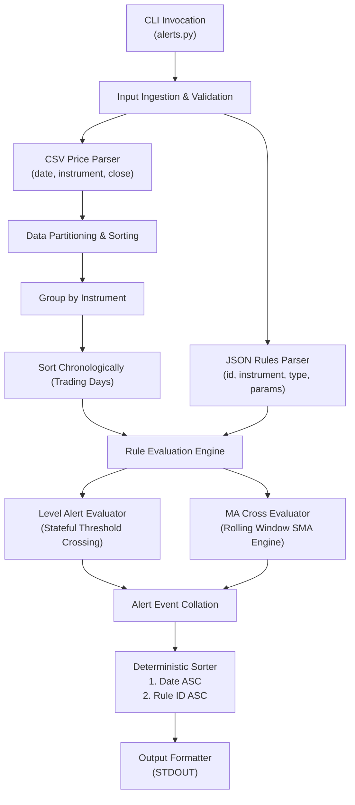

# AGENTS.md — AI Agent Guidelines & Engineering Blueprint
## Wissen Technology: Price Alert Tool

---

### 1. Purpose & Agent Persona

This document serves as the architectural contract, operational handbook, and AI pair-programming guide for building, testing, and presenting the **Price Alert Tool** for the Wissen Technology Campus Assessment.

Agents (and developers paired with agents) working on this codebase must adhere strictly to the engineering principles, mathematical definitions, and validation strategies outlined below.

---

### 2. High-Level System Architecture

To ensure zero external dependencies, high execution speed, and testability, the codebase must be designed using clean Python standard library modules (`csv`, `json`, `sys`, `datetime`, `collections`, `typing`).



#### Core Components
1. **Parser & Ingestion (`ingestion.py` / internal parser):**
   - Parses `prices.csv` resiliently (handles trailing whitespace, ensures numeric parsing of `close`, parses dates into comparable `datetime.date` objects).
   - Parses `rules.json` and instantiates strongly typed rule objects.
2. **Data Model (`models.py`):**
   - Immutable data structures / Dataclasses:
     - `PriceRow(date: datetime.date, instrument: str, close: float)`
     - `LevelRule(id: str, instrument: str, direction: str, level: float)`
     - `MACrossRule(id: str, instrument: str, short: int, long: int, direction: str)`
     - `AlertEvent(date: datetime.date, rule_id: str, instrument: str, text: str)`
3. **Stateful Rule Engine (`engine.py`):**
   - Evaluates each instrument's sequential series independently.
   - Maintains rolling state without quadratic recalculations ($O(N)$ time complexity).
4. **Alert Sorter & Formatter (`formatter.py`):**
   - Collects all generated events.
   - Sorts strictly by `(event.date, event.rule_id)`.
   - Formats strings to match the exact assessment specification.

---

### 3. AI Assistant Collaboration Guide & Prompting Protocol

The assessment explicitly evaluates:
> 1. *"How you used the assistant (the prompts in brief)"*
> 2. *"What the assistant got wrong, and what you changed and why"*
> 3. *"Your presentation: six minutes on what it does, how you verified it, and one thing the assistant got wrong"*

To maximize credibility, the interaction with AI assistants must be methodically structured, logged, and audited.

#### 3.1 Prompting Blueprint
When generating or refining code with AI, follow this 4-stage sequence:

| Phase | Purpose | Example Prompt Synopsis |
| :--- | :--- | :--- |
| **Phase 1: Architecture & Modeling** | Define immutable data models and CLI signature | *"Design standard-library Python dataclasses and type definitions for a price alert engine with two rule types: level and ma_cross."* |
| **Phase 2: Stateful Rule Logic** | Isolate mathematical crossing logic | *"Write a pure stateful evaluator for level crossing and SMA crossover. Ensure it operates on sorted trading days and handles the initial window correctly."* |
| **Phase 3: Hostile Edge-Case Testing** | Write comprehensive test suites before main code | *"Write pytest unit tests covering out-of-order CSV dates, identical date duplicate rows, price touching the exact level, and data shorter than the MA long window."* |
| **Phase 4: CLI Glue & Ordering** | Final CLI runner with stdout formatting | *"Implement alerts.py to read CLI arguments, coordinate ingestion, execute evaluation, sort alerts by date then rule_id, and print output."* |

---

### 4. Known AI Hallucinations, Traps & Mitigations

Below are the exact mistakes AI models typically make on this problem statement. These serve as verified material for the **README** and the **6-minute presentation**.

#### Trap 1: The "Moving Average Window Warming" Off-by-One Error
- **The AI Mistake:**
  When implementing `ma_cross`, AI assistants often check:
  ```python
  # WRONG AI IMPLEMENTATION
  if len(window) >= long_window:
      short_ma = sum(window[-short:]) / short
      long_ma = sum(window[-long:]) / long
      if short_ma > long_ma and prev_short_ma <= prev_long_ma:
          fire_alert(...)
  ```
  On the very first day that `len(window) == long_window` (day $L$):
  - `prev_long_ma` is either uninitialized, set to `0`, or set to `None`.
  - If initialized to `0` or `float('-inf')`, the AI code erroneously concludes that a crossover occurred from "below" on day $L$, generating a **false alert on the first window-completion day**.
- **The Correct Technical Fix:**
  A crossover requires observing the transition between day $t-1$ and day $t$. Since day $L$ is the *first* day the long MA is defined, day $L-1$ had no valid long MA. Therefore:
  - Day $L$ establishes the baseline relationship (`short_ma` relative to `long_ma`).
  - Day $L+1$ is the earliest possible day a valid crossover alert can fire.

#### Trap 2: String Sorting vs Chronological Date Sorting
- **The AI Mistake:**
  AI frequently writes:
  ```python
  # RISKY AI CODE
  alerts.sort(key=lambda a: (a.date, a.rule_id))
  ```
  If `a.date` is kept as a raw string from the CSV, non-padded dates (e.g., `2026-9-3` vs `2026-09-03` or differing formats) sort incorrectly lexicographically.
- **The Correct Technical Fix:**
  Always parse `date` into a `datetime.date` object for time-series ordering and cross-checking, while preserving or reformatting to `YYYY-MM-DD` on output.

#### Trap 3: Calendar Days vs Trading Days Gap Interpolation
- **The AI Mistake:**
  AI models often assume missing dates (weekends, holidays) should be padded with forward-filled prices, or they compute rolling windows using calendar intervals (e.g., `timedelta(days=20)`).
- **The Correct Technical Fix:**
  The brief states: *"one row per instrument per trading day... Moving averages need a full window of days before they are defined."*
  Moving averages must be calculated strictly across the last $N$ consecutive **trading rows** for that instrument, regardless of calendar gaps.

#### Trap 4: Boundary Touch vs Directional Crossing
- **The AI Mistake:**
  AI assistants often conflate "touching a level" with "crossing a level":
  ```python
  # AMBIGUOUS AI CODE
  if prev_close >= level and curr_close <= level:  # Fires even if price was at level and remained at level!
  ```
- **The Correct Technical Fix:**
  A crossing in the `below` direction requires transitioning from the strictly higher side ($P_{t-1} > \text{level}$) to below the level ($P_t < \text{level}$). If the price was already at the level or below the level, no crossing occurred.

#### Trap 5: Secondary Sort by Rule ID Neglected
- **The AI Mistake:**
  AI models often group alerts by date or instrument and print them in arbitrary hash-map iteration order.
- **The Correct Technical Fix:**
  Sort all generated alerts with a compound key: `(alert.date, alert.rule_id)` in ascending order.

---

### 5. Mandatory Test Suite Matrix

The evaluation team reads the test suite first. The tests must be organized into clear categories:

```
tests/
├── test_parser.py           # Valid & malformed CSV/JSON, disordered input
├── test_level_alerts.py     # Threshold crossings, boundary conditions, repeated days
├── test_ma_cross_alerts.py  # Window definitions, day L vs L+1, golden/death cross
├── test_multi_instrument.py # Independent ticker evaluation, interleaved rows
└── test_e2e_cli.py          # Subprocess CLI tests, exact stdout formatting matching brief
```

#### Test Cases Coverage Checklist
- [x] **Sample Verification:** Exact reproduction of the brief's sample output for `2026-09-03 r1 INFY` and `2026-09-24 r2 TCS`.
- [x] **Out-of-Order Dates:** Shuffled CSV rows processed into identical output.
- [x] **Insufficient Data:** Price history with fewer days than `long` window producing no `ma_cross` alerts and no exceptions.
- [x] **Identical Price / Zero Volatility:** Flat price series ($1500, 1500, 1500$) never triggering level or MA cross alerts.
- [x] **Touching Boundary:** Price moving from $1520 \to 1500 \to 1498$.
- [x] **Oscillation:** Rapid zigzag across threshold triggering alerts on every true transition.
- [x] **Multiple Rules Same Instrument Same Day:** Both a `level` rule and `ma_cross` rule triggering on the same date, ordered correctly by `rule_id`.
- [x] **Silent Days:** Verify that no empty lines or header artifacts are printed on inactive days.

---

### 6. Standard Presentation & Evaluation Defense Script

Use this structured defense for the mandatory 12-minute assessment slot:

```
[00:00 - 02:00] System Overview & Clean Architecture
  - Single-command execution: python alerts.py prices.csv rules.json (0 external dependencies).
  - Clean separation: Ingestion -> In-Memory Time-Series Indexing -> Stateful Rule Engine -> Collation.
  - Linear time complexity O(N log N) dominated solely by initial date sorting.

[02:00 - 04:00] Verification & Test Strategy
  - Walk through tests/ directory (highlighting boundary touch, window warm-up, and multi-ticker interleaving).
  - Demonstrate deterministic ordering (date ASC, rule_id ASC).

[04:00 - 06:00] The AI Assistant Deep Dive (Mandatory Assessment Topic)
  - Explain the exact prompt used to generate the MA cross evaluator.
  - Highlight the AI's bug: Firing a false positive crossover on Day L due to uninitialized/zero previous long MA.
  - Explain the fix: Requiring both short and long MAs to have defined historical states on day t-1, establishing Day L+1 as the true first evaluatable crossover day.

[06:00 - 12:00] Interactive Q&A with Evaluators
  - Run the CLI against the panel's secret unseen test files.
  - Explain handling of edge cases directly from code.
```
